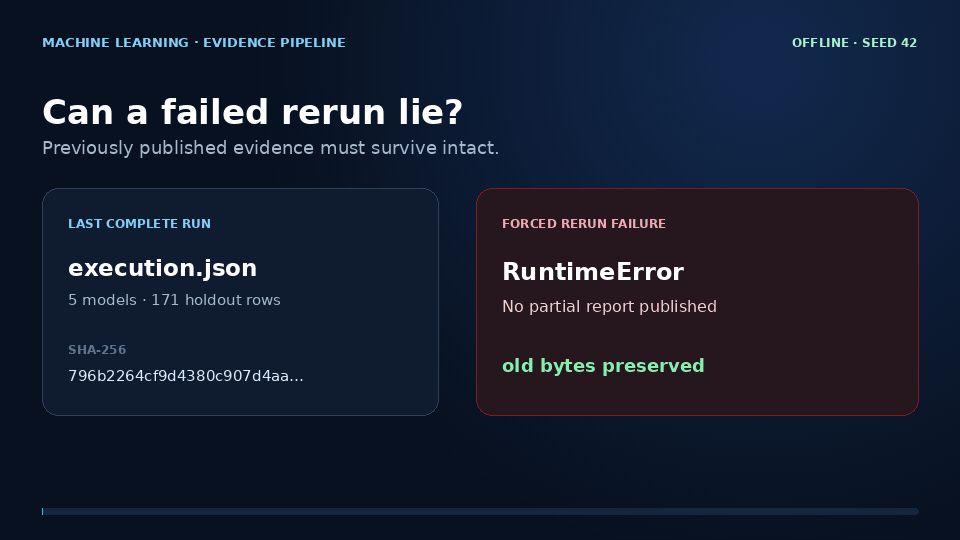

# machine_learning

## Demo: fail-closed research evidence



[MP4 version](docs/demo/machine-learning-demo.mp4) · [source and artifact receipt](docs/demo/capture.json)

This 15-second recording is generated from the actual provider-free notebook workflow and its integrity regressions. It shows a fixed 70/30 educational holdout; the displayed scores are descriptive results from that one checked split, not clinical validation or a claim of medical utility.

## Reproduce the checked research workflow

```bash
python -m venv .venv
. .venv/bin/activate
pip install -r requirements.txt
python run_research.py 'Ensemble_Methods_for_Breast_Cancer_Dataset.ipynb'
```

Five ensemble models train on the built-in Wisconsin Diagnostic Breast Cancer dataset, with a stratified 70/30 split. This is an educational fixed holdout evaluation, not a medical decision system or independent validation study. The current notebook writes `execution.json` to `research-output/`; if a future notebook opens Matplotlib figures, the runner will save those too. The runner executes the original code cells, stops on errors, seeds NumPy to 42, and uses a headless plotting backend.

Output publication is transactional: a run is assembled in a staging directory and replaces `research-output/` only after every notebook cell and artifact write succeeds. If a rerun fails, the last complete evidence directory remains byte-for-byte unchanged instead of being mixed with partial or stale results. The manifest records the executed cells and notebook SHA-256. Exact dependency pins make the checked source and the published descriptive scores reproducible in CI.

```bash
python -m unittest discover -s tests -v
```

Runnable notebooks: `Ensemble_Methods_for_Breast_Cancer_Dataset.ipynb`.
